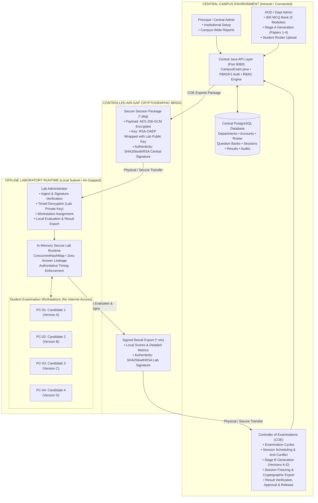

# Maharaja Institute of Technology Mysore Examination System

The **Maharaja Institute of Technology Mysore (MIT Mysore) Examination System** is an institutional-grade, highly secure examination management and delivery platform. Engineered following the formal blueprint specified in [`/docs/MIT_Architecture_and_Workflow.pdf`](file:///C:/Users/Vaishak%20M/Downloads/proj/CampusExam-Java-PostgreSQL/CampusExam/docs/MIT_Architecture_and_Workflow.pdf), the system enforces strict administrative role boundaries, automated multi-stage paper generation, cryptographic air-gap isolation between the campus network and offline testing laboratories, authoritative local session evaluation, and controlled result publication with immutable audit logging.

---

## Table of Contents

1. [Architectural Overview](#architectural-overview)
2. [Dual-Environment Model & Security Boundary](#dual-environment-model--security-boundary)
3. [User Roles & Access Control Model](#user-roles--access-control-model)
4. [Question Paper Generation Engines](#question-paper-generation-engines)
   - [Stage A: Numbered Paper Generation Engine](#stage-a-numbered-paper-generation-engine)
   - [Stage B: Lettered Version Permutation Engine](#stage-b-lettered-version-permutation-engine)
5. [End-to-End System Workflow](#end-to-end-system-workflow)
6. [Cryptographic Architecture & Security Specifications](#cryptographic-architecture--security-specifications)
7. [Database Schema & Data Models](#database-schema--data-models)
8. [Complete REST API Reference](#complete-rest-api-reference)
9. [User Portals & Frontend Architecture](#user-portals--frontend-architecture)
10. [Local Setup, Execution & Testing](#local-setup-execution--testing)

---

## Architectural Overview

The system is constructed with a minimalist, high-performance architecture:
- **Backend Core**: Standalone Java 17 service (`CampusExam.java`) utilizing standard Java standard library HTTP server (`com.sun.net.httpserver.HttpServer`), custom streaming zero-dependency JSON parser/serializer, multithreaded connection pool, and asynchronous token expiration reaper.
- **Relational Persistence**: PostgreSQL with strictly typed relational tables, foreign key cascades, unique constraints, and atomic transaction isolation.
- **Client Interfaces**: Self-contained, responsive modern single-page applications (`index.html` and `app.html`) providing dedicated role workspaces without external heavyweight framework dependencies.
- **Cryptographic Subsystem**: Dual asymmetric RSA-2048 keypairs, symmetric AES-256-GCM authenticated cipher envelopes, RSA-OAEP key wrapping, and digital signatures.



---

## Dual-Environment Model & Security Boundary

To achieve zero question paper leakage and complete immunity against network eavesdropping, the architecture maintains a strict physical and logical separation:

| Dimension | Central Administrative Environment | Offline Laboratory Runtime |
| :--- | :--- | :--- |
| **Network Connectivity** | Connected to institutional LAN / Intranet | Fully isolated, air-gapped laboratory local subnet (No Internet access) |
| **Data Storage** | PostgreSQL persistent database (`campusexam`) | In-memory secure memory runtime (`LabRuntime`) during active sitting |
| **Question Bank Visibility** | Full question bank & module access (HOD only) | Decrypted paper versions loaded into memory only at scheduled start time |
| **Answer Key Exposure** | Restored in DB; strictly hidden from COE | Held in secure server memory; never transmitted to student client |
| **Authentication Mode** | Username + PBKDF2-HMAC-SHA256 salted password | USN + Date of Birth verified against frozen roster snapshot |
| **Results Processing** | Signature verification, statistical review, release | Local real-time evaluation against decrypted answer keys |

---

## User Roles & Access Control Model

The backend applies strict Role-Based Access Control (RBAC) and department-level boundary checks:

```
               [PRINCIPAL / CENTRAL ADMIN]
                            |
           +----------------+----------------+
           |                                 |
       [HOD CSE]                         [HOD ISE]              [COE]
           |                                 |                    |
   Scoped to CSE only               Scoped to ISE only     Campus-Wide Scheduling
   (Cross-dept -> 403)              (Cross-dept -> 403)    (No Question Text Access)
                                                                  |
                                                           [LAB ADMINISTRATOR]
                                                                  |
                                                           [STUDENT WORKSTATION]
```

### 1. Principal / Central Administrator (`PRINCIPAL`, `ADMIN`)
- **Institutional Governance**: Creates and manages academic departments (`department`), academic groups/sections (`academic_group`), and institutional subject offerings (`subject`).
- **Account Provisioning**: Sets up HOD accounts bound to specific department IDs, campus-wide COE accounts, and Laboratory Administrator accounts.
- **Reporting & Governance**: Accesses campus-wide macro analytics (total scheduled/completed exams, institutional pass percentage, department comparisons) and inspects the immutable system audit trail.

### 2. Head of Department (`HOD`)
- **Strict Department Scoping**: The backend verifies `user.departmentId == targetDeptId` on all bank and roster operations. Any attempt to read or modify another department's question banks or subjects is blocked with `403 Forbidden`.
- **Question Bank Curation**: Prepares question banks containing exactly **300 MCQs** divided evenly across **5 modules** (60 questions per module).
- **Quality & Structural Verification**: Validates question prompt, 4 distinct answer options, valid 1-based answer key (1–4), explanation text, and stable unique identifier (`question_uid`).
- **Student Roster Management**: Uploads official student cohorts for academic groups with University Seat Number (USN), Full Name, and Date of Birth (DOB).
- **Stage A Finalization**: Locks the bank into `FINALIZED` state and triggers Stage A generation of 4 non-overlapping balanced examination papers.
- **Departmental Result Review**: Obtains detailed student performance breakdowns for departmental subjects once results are formally released by COE.

### 3. Controller of Examinations (`COE`)
- **Cycle & Session Scheduling**: Configures examination cycles (e.g., Internal Assessment 1, End Semester Examination) and schedules examination sittings (Date, Morning/Afternoon session, Start/End times, Duration, and Assigned Laboratory).
- **Conflict Prevention Engine**: Actively prevents laboratory double-booking. Scheduling two sessions in the same physical laboratory for the same date and sitting triggers `409 Conflict`.
- **Protected Question Boundary**: The COE can inspect paper headers and metadata, but the backend **strictly strips question prompts, options, and answer keys** from COE API views.
- **Stage B Generation Trigger**: COE selects a numbered paper from the finalized bank, triggering the Stage B version generation engine (creating Versions A, B, C, and D).
- **Session Freezing**: Freezes the candidate roster snapshot and exam parameters, transitioning session status to `FROZEN`.
- **Cryptographic Export**: Generates the encrypted and signed session package targeted at the assigned lab server.
- **Result Verification & Release**: Ingests signed laboratory result payloads, cryptographically validates the lab's digital signature, reviews attendance and grade distributions, approves the sitting, and formally releases results.
- **Paper Retirement**: Upon release, the selected paper is marked `RETIRED` / `CONSUMED`, guaranteeing that the same question set is never repeated in future cycles.

### 4. Laboratory Administrator (`LAB_ADMIN`)
- **Package Ingestion & Verification**: Receives the encrypted session package and verifies the Central Backend's digital signature.
- **Scheduled Session Decryption**: At the authorized sitting time, decrypts the package into volatile memory (`LabRuntime`) using the laboratory's private key.
- **Workstation Configuration**: Maps laboratory computers (PC-01, PC-02, etc.) to balanced paper versions (A, B, C, D).
- **Session Monitoring**: Monitors candidate check-in and active exam progress.
- **Local Scoring & Signed Export**: Executes local evaluation of student submissions against decrypted answer keys, computes statistics (pass %, averages, highest score, attendance), and exports a digitally signed result file.

### 5. Student Candidate (`STUDENT`)
- **Offline Authentication**: Logs in at an assigned laboratory computer using **USN + Date of Birth** authenticated against the frozen local session roster snapshot.
- **Assigned Version Delivery**: Receives the specific lettered version mapped to the workstation. The client payload includes question prompts and shuffled options, but **completely omits answer keys and explanations**.
- **Local Real-Time Answering**: Selects options (1–4) with instant local persistence and review flags.
- **Submission & Receipt**: Submits the completed exam to receive an authoritative confirmation code; scores and answer keys are withheld to preserve testing integrity.

---

## Question Paper Generation Engines

The examination platform employs a **two-stage automated generation architecture** to eliminate human bias, ensure curricular balance, and prevent laboratory cheating:

```
[300 MCQs in Question Bank]
(60 Questions per Module x 5 Modules)
            |
            v  [HOD Bank Finalization]
========================================================================
STAGE A ENGINE: 4 Numbered Prepared Papers (30 Questions Each)
========================================================================
• Paper 1: 6 Qs from M1, 6 Qs from M2, 6 Qs from M3, 6 Qs from M4, 6 Qs from M5
• Paper 2: 6 Qs from M1, 6 Qs from M2, 6 Qs from M3, 6 Qs from M4, 6 Qs from M5
• Paper 3: 6 Qs from M1, 6 Qs from M2, 6 Qs from M3, 6 Qs from M4, 6 Qs from M5
• Paper 4: 6 Qs from M1, 6 Qs from M2, 6 Qs from M3, 6 Qs from M4, 6 Qs from M5
(Rule: 0 Question Overlap across Papers 1, 2, 3, and 4)
            |
            v  [COE Selects Paper (e.g., Paper 1)]
========================================================================
STAGE B ENGINE: 4 Lettered Versions for Selected Paper
========================================================================
• Version A: Question Order Permutation 1 | Option Shuffling Set 1
• Version B: Question Order Permutation 2 | Option Shuffling Set 2
• Version C: Question Order Permutation 3 | Option Shuffling Set 3
• Version D: Question Order Permutation 4 | Option Shuffling Set 4
(Rule: Stable Question UIDs; correct answer indices adjusted dynamically)
```

### Stage A: Numbered Paper Generation Engine
Executed automatically when an HOD finalizes a verified 300-question question bank:
1. **Module Partitioning**: Questions are grouped into 5 module pools ($M_1, M_2, M_3, M_4, M_5$), each containing 60 validated MCQs.
2. **Disjoint Sampling**: The engine draws 6 distinct questions from each module pool per paper:
   $$\text{Paper}_i = \bigcup_{m=1}^{5} \text{Sample}_{6}(M_m \setminus \text{Used}_m)$$
3. **Zero Overlap Guarantee**: Across all 4 generated papers ($\text{Paper } 1, 2, 3, 4$), each question appears at most once:
   $$\text{Paper}_j \cap \text{Paper}_k = \emptyset \quad \forall j \neq k$$
   Total questions utilized = $4 \text{ papers} \times 30 \text{ questions} = 120 \text{ questions}$ (leaving 180 questions in the bank pool).
4. **Relational Storage**: Paper definitions are saved in `generated_paper` and question mappings in `generated_paper_question`.

### Stage B: Lettered Version Permutation Engine
Executed when the COE schedules a session and binds a prepared paper set:
1. **Base Paper Selection**: COE designates one of the ready paper sets (e.g., Paper 1).
2. **Four Distinct Versions**: The engine synthesizes 4 exam versions designated **A, B, C, and D**.
3. **Dual Permutation Strategy**:
   - **Question Order Permutation**: The 30 questions are pseudo-randomly shuffled for each version letter, ensuring adjacent candidates do not encounter questions in the same sequence.
   - **Option Choice Permutation**: The 4 option choices per question are shuffled. The engine dynamically maps the original `correct` choice index (1–4) to its new position in the permuted options array.
4. **Traceability**: Every permuted question preserves its parent `question_uid`, allowing the evaluation engine to cross-reference responses accurately.

---

## End-to-End System Workflow

```mermaid
sequenceDiagram
    autonumber
    actor Principal as Principal / Central Admin
    actor HOD as Head of Department
    actor COE as Controller of Exams
    actor Lab as Lab Administrator
    actor Student as Student Candidate

    %% 1. Setup
    rect rgb(20, 27, 45)
    Note over Principal,HOD: Phase 1: Institutional Provisioning
    Principal->>HOD: Create Department (e.g., CSE) & Provision Scoped HOD Account
    Principal->>COE: Provision Controller of Examinations Account
    Principal->>Lab: Provision Lab Administrator Account
    end

    %% 2. Bank & Roster
    rect rgb(24, 32, 54)
    Note over HOD,COE: Phase 2: Question Bank Curation & Stage A Generation
    HOD->>HOD: Upload Student Roster (USN, Name, DOB)
    HOD->>HOD: Upload 300 MCQs across 5 Modules (60 Qs/Module)
    HOD->>HOD: Finalize Question Bank
    Note right of HOD: Stage A Engine synthesizes Papers 1, 2, 3, 4 (0 overlap)
    end

    %% 3. Scheduling & Packaging
    rect rgb(20, 27, 45)
    Note over COE,Lab: Phase 3: Scheduling, Stage B & Package Export
    COE->>COE: Create Exam Cycle & Schedule Session (Date, Lab, Sitting)
    COE->>COE: Select Prepared Paper -> Triggers Stage B Engine (Versions A, B, C, D)
    COE->>COE: Freeze Session & Candidate Snapshot
    COE->>COE: Export Encrypted & Signed Session Package
    COE->>Lab: Physical / Secure Transfer of Package
    end

    %% 4. Offline Lab Execution
    rect rgb(24, 32, 54)
    Note over Lab,Student: Phase 4: Offline Lab Ingestion & Examination
    Lab->>Lab: Ingest Package & Verify Central Backend Signature
    Lab->>Lab: Timed Decryption using Lab RSA Private Key into Memory
    Lab->>Lab: Map Workstations to Versions (PC-01->A, PC-02->B, etc.)
    Student->>Lab: Authenticate with USN + DOB at Workstation
    Lab-->>Student: Deliver Assigned Version (No Answer Keys / Explanations)
    Student->>Lab: Submit Responses
    Lab-->>Student: Issue Submission Confirmation Code
    end

    %% 5. Evaluation & Release
    rect rgb(20, 27, 45)
    Note over Lab,Principal: Phase 5: Local Evaluation, Verification & Release
    Lab->>Lab: Evaluate MCQ Answers against Decrypted Keys & Compute Metrics
    Lab->>COE: Export Digitally Signed Results Payload
    COE->>COE: Ingest Results & Verify Lab Digital Signature
    COE->>COE: Review Metrics, Approve Sitting & Formally Release Results
    Note right of COE: Selected Paper set marked as RETIRED / CONSUMED
    COE->>HOD: HOD accesses departmental student performance
    COE->>Principal: Principal reviews campus completion rates & immutable audit
    end
```



---

## Cryptographic Architecture & Security Specifications

The system enforces cryptographic protection for credential storage, air-gapped transit, session confidentiality, and non-repudiation:

| Cryptographic Task | Algorithm / Standard | Parameters / Key Size | Purpose & Security Guarantee |
| :--- | :--- | :--- | :--- |
| **Credential Storage** | `PBKDF2WithHmacSHA256` | 600,000 iterations, 128-bit random salt, 256-bit derived key | Defense against brute-force and dictionary attacks on user passwords |
| **Session Token Digest** | `SHA-256` | 256-bit hash of 32-byte secure random token | Prevents token disclosure in persistent database records |
| **Package Symmetric Encryption** | `AES/GCM/NoPadding` | 256-bit AES key, 96-bit (12-byte) random IV, 128-bit auth tag | Confidentially encrypts session versions, roster snapshot, and answer keys |
| **Asymmetric Key Wrapping** | `RSA/ECB/OAEPWithSHA-256AndMGF1Padding` | RSA 2048-bit Public Key (Lab Server) | Securely wraps AES symmetric key for the designated lab server |
| **Central Backend Signature** | `SHA256withRSA` | RSA 2048-bit Private Key (Central Server) | Digitally signs package envelope; enables offline lab verification |
| **Laboratory Result Signature** | `SHA256withRSA` | RSA 2048-bit Private Key (Lab Server) | Digitally signs evaluated result file; guarantees authenticity to COE |

### Cryptographic Package Envelope Structure
When COE exports a session package, the resulting JSON payload adheres to the following structure:
```json
{
  "packageUid": "PKG-20261116-SESSION-42-A1B2C3",
  "sessionId": 42,
  "encryptedPayload": "<Hex-encoded AES-256-GCM ciphertext of session data>",
  "encryptedKeyHex": "<Hex-encoded RSA-OAEP wrapped AES key>",
  "ivHex": "<Hex-encoded 12-byte AES-GCM IV>",
  "digestHex": "<Hex-encoded SHA-256 digest of unencrypted payload>",
  "signatureHex": "<Hex-encoded SHA256withRSA signature generated by Central Private Key>"
}
```

---

## Database Schema & Data Models

The persistence layer (`schema.sql`) implements normalized, relational tables supporting institutional management, offline staging, and audit logging:

```
[department] 1---* [academic_group] 1---* [student_roster]
     |                     |                      |
     | 1---* [subject]     |                      +---* [session_roster_snapshot]
     |          |          |                                   |
     | 1---* [account]     |                                   |
     |          |          |                                   |
     |          +---* [question_bank] 1---* [question_bank_item]  |
     |                     |                                   |
     |                     +---* [generated_paper]             |
     |                                 |                       |
     | 1---* [examination_session] <---+                       |
                   |                                           |
                   +---* [paper_version] 1---* [paper_version_question]
                   +---* [computer_assignment]
                   +---* [secure_package]
                   +---* [lab_result_import] 1---* [student_session_result]
```

### Table Summary
- **`department`**: Academic department codes (e.g., `CSE`, `AIML`, `ISE`) and descriptive names.
- **`academic_group`**: Cohort classifications defined by department, academic year, semester, and section.
- **`subject`**: Course definitions linked to academic departments and semesters.
- **`account`**: User accounts with `role` (`PRINCIPAL`, `ADMIN`, `HOD`, `COE`, `LAB_ADMIN`, `STUDENT`), PBKDF2 hash, and optional department scoping.
- **`session_token`**: Active session authentication tokens hashed with SHA-256 with auto-expiration.
- **`student_roster`**: Master roster of enrolled candidates containing USN, Full Name, Date of Birth, and Group ID.
- **`question_bank`**: Header record for curated banks (5 Modules x 60 Questions) with workflow states (`DRAFT`, `FINALIZED`, `ARCHIVED`).
- **`question_bank_item`**: Individual MCQs with module number (1–5), question prompt, 4 options, 1-based answer key, marks, and explanation.
- **`generated_paper`**: Stage A generated numbered papers (1–4) per bank set with state tracking (`READY`, `SELECTED`, `CONSUMED`, `RETIRED`).
- **`generated_paper_question`**: 30 questions linked to each Stage A generated paper (6 from each of the 5 modules).
- **`examination_cycle`**: Examination terms (Internal Assessment, End Semester Examination).
- **`examination_session`**: Scheduled examination sittings specifying date, sitting (Morning/Afternoon), assigned lab, timing, selected paper, and status (`SCHEDULED`, `FROZEN`, `PACKAGE_EXPORTED`, `RESULTS_IMPORTED`, `APPROVED`, `RELEASED`).
- **`paper_version`**: Stage B versions (A, B, C, D) generated for a session's selected paper.
- **`paper_version_question`**: Questions belonging to lettered versions with permuted question orders and shuffled option sets.
- **`session_roster_snapshot`**: Frozen roster of eligible students locked at session finalization.
- **`computer_assignment`**: Mapping between physical laboratory computers and lettered versions.
- **`secure_package`**: Encrypted and signed export package metadata and cryptographic envelope.
- **`lab_result_import`**: Imported result metadata, statistical summary, and status (`IMPORTED`, `APPROVED`, `RELEASED`).
- **`student_session_result`**: Evaluated candidate results including correct/incorrect counts, final score, and pass/fail determination.
- **`audit`**: Immutable, append-only log capturing timestamp, actor ID, action name, entity reference, and details.

---

## Complete REST API Reference

All requests and responses use JSON (`application/json; charset=utf-8`). Authenticated endpoints require standard `Authorization: Bearer <64-hex-token>` headers.

### 1. Authentication & System
| Method | Endpoint | Role Required | Description |
| :--- | :--- | :--- | :--- |
| `GET` | `/api/health` | Public | System health check and status confirmation |
| `POST` | `/api/login` | Public | Authenticates admin/faculty via `username` and `password` |
| `POST` | `/api/logout` | Authenticated | Revokes current session token |
| `GET` | `/api/me` | Authenticated | Retrieves current user profile, role, and department scope |
| `GET` | `/api/audit` | `PRINCIPAL`, `COE`, `ADMIN` | Fetches immutable system audit records |

### 2. Principal / Central Admin APIs
| Method | Endpoint | Parameters / Body | Description |
| :--- | :--- | :--- | :--- |
| `POST` | `/api/principal/departments` | `code`, `name` | Creates a new academic department |
| `GET` | `/api/principal/departments` | None | Lists all registered academic departments |
| `POST` | `/api/principal/academic-groups` | `department_id`, `session`, `year`, `semester`, `section` | Creates a new student section group |
| `GET` | `/api/principal/academic-groups` | None | Lists all academic groups |
| `POST` | `/api/principal/subjects` | `department_id`, `code`, `name`, `semester` | Registers a curriculum subject |
| `GET` | `/api/principal/subjects` | None | Lists all curriculum subjects |
| `POST` | `/api/principal/accounts` | `username`, `password`, `role`, `department_id`, `full_name` | Provisions institutional accounts (HOD, COE, Lab Admin) |
| `GET` | `/api/principal/accounts` | None | Lists institutional user accounts |
| `GET` | `/api/principal/reports` | None | Computes campus-wide completion rates and exam statistics |

### 3. HOD / Department Admin APIs
| Method | Endpoint | Parameters / Body | Description |
| :--- | :--- | :--- | :--- |
| `POST` | `/api/hod/upload-roster` | `group_id`, `roster: [...]` | Bulk uploads student roster (USN, Full Name, DOB) |
| `GET` | `/api/hod/roster?group_id=<id>` | `group_id` | Retrieves enrolled students for an academic group |
| `POST` | `/api/hod/question-bank` | `subject_id`, `session`, `semester`, `title` | Initializes a department-scoped question bank |
| `GET` | `/api/hod/question-banks` | None | Lists question banks belonging to the HOD's department |
| `GET` | `/api/hod/bank-details?id=<id>` | `id` | Fetches question bank items, module breakdown, and status |
| `POST` | `/api/hod/upload-questions` | `bank_id`, `questions: [...]` | Bulk uploads MCQs (module 1–5, prompt, 4 options, key) |
| `POST` | `/api/hod/finalize-bank` | `bank_id` | Validates 300 questions & triggers **Stage A Paper Engine** |
| `GET` | `/api/hod/results` | None | Views released departmental examination scores and statistics |

### 4. Controller of Examinations (COE) APIs
| Method | Endpoint | Parameters / Body | Description |
| :--- | :--- | :--- | :--- |
| `POST` | `/api/coe/cycle` | `title`, `session`, `cycle_type` | Defines an examination cycle (e.g., Semester Exam) |
| `GET` | `/api/coe/cycles` | None | Lists all configured examination cycles |
| `POST` | `/api/coe/session` | `cycle_id`, `subject_id`, `session_date`, `sitting`, `assigned_lab`, etc. | Schedules a sitting with automatic conflict detection |
| `GET` | `/api/coe/sessions` | None | Lists all scheduled examination sessions |
| `GET` | `/api/coe/papers?bank_id=<id>` | `bank_id` | Inspects paper set metadata (question text strictly omitted) |
| `POST` | `/api/coe/select-paper` | `session_id`, `paper_id` | Binds paper set & triggers **Stage B Version Engine (A–D)** |
| `POST` | `/api/coe/finalize-session` | `session_id` | Freezes session parameters and snapshot of eligible candidates |
| `POST` | `/api/coe/export-package` | `session_id` | Exports AES-256-GCM + RSA-OAEP encrypted & signed package |
| `POST` | `/api/coe/import-results` | `sessionId`, `resultPayloadJson`, `labSignatureHex` | Ingests and verifies digitally signed lab results |
| `POST` | `/api/coe/approve-results` | `sessionId` | Approves verified results based on statistical metrics |
| `POST` | `/api/coe/release-results` | `sessionId` | Formally releases results to HOD/Principal and **retires paper set** |

### 5. Laboratory Management & Student Workstation APIs
| Method | Endpoint | Parameters / Body | Description |
| :--- | :--- | :--- | :--- |
| `POST` | `/api/lab/package/import` | Cryptographic Package JSON | Verifies Central digital signature and registers package |
| `POST` | `/api/lab/activate` | `sessionId` | Decrypts session into secure memory (`LabRuntime`) |
| `POST` | `/api/lab/configure-computers`| `sessionId`, `mappings: [...]` | Assigns workstation IDs to lettered versions (A–D) |
| `POST` | `/api/lab/evaluate-and-export`| `sessionId` | Runs local MCQ evaluation and exports signed result payload |
| `POST` | `/api/student/login` | `usn`, `dob`, `computer_number` | Authenticates candidate against frozen session roster |
| `GET` | `/api/student/paper` | Student Bearer Token | Delivers assigned version questions (answer keys omitted) |
| `POST` | `/api/student/answer` | `question_uid`, `choice`, `review` | Saves student MCQ choice in active memory |
| `POST` | `/api/student/submit` | Student Bearer Token | Finalizes student exam and returns confirmation code |

---

## User Portals & Frontend Architecture

The web application [`index.html`](file:///C:/Users/Vaishak%20M/Downloads/proj/CampusExam-Java-PostgreSQL/CampusExam/index.html) delivers a unified, dark-themed responsive console organizing all user workflows into clean, role-tailored workspaces:

```
+---------------------------------------------------------------------------------------+
|  MAHARAJA INSTITUTE OF TECHNOLOGY MYSORE - EXAMINATION MANAGEMENT SYSTEM             |
|  [Institutional Administrative Portal & Secure Examination Runtime]                   |
+---------------------------------------------------------------------------------------+
| [1. Sign In] [2. Student Exam] [3. Principal] [4. HOD] [5. COE] [6. Lab] [7. Audit]   |
+---------------------------------------------------------------------------------------+
```

1. **Sign In Tab**: Fast authentication for Principal, HOD, COE, and Lab Administrator accounts with token persistence in browser session storage.
2. **Student Examination Portal**: Minimalist, distraction-free examination screen featuring candidate identification banner, question palette navigation (1–30), question prompt card, clear multiple-choice options, review flagging, and final submission with confirmation receipt.
3. **Principal Portal**: Institutional configuration interface for managing colleges, academic departments, study years, semesters, sections, subjects, user provisioning, and high-level institutional pass rates.
4. **HOD Portal**: Department-scoped cockpit providing roster upload, question bank drafting, bulk question uploading across modules 1–5, Stage A paper generation trigger, and released exam score inspection.
5. **COE Portal**: Examination cycle definitions, sitting scheduling with conflict warnings, prepared paper set selection, Stage B version generator monitor, session freezing, secure package exporter, result ingestion, and release triggers.
6. **Lab Management Console**: Package verification and ingestion console, timed memory activation, computer-to-version mapping manager, live exam attendance monitor, and digitally signed result exporter.
7. **Audit Trail**: Real-time tabular viewer tracking chronological administrative actions, actor IDs, affected entities, and action metadata.

---

## Local Setup, Execution & Testing

### Prerequisites
- **Java Development Kit**: JDK 17 or later (`javac`, `java`)
- **PostgreSQL Database**: Version 14 or later with JDBC driver (`postgresql.jar` included in `lib/`)
- **Python**: Version 3.8+ (for test suites)
- **PowerShell / Terminal**: Standard Windows PowerShell or Unix Shell

### 1. Database Initialization
Create a PostgreSQL database and user:
```sql
CREATE DATABASE campusexam;
CREATE USER campusexam WITH PASSWORD 'password';
GRANT ALL PRIVILEGES ON DATABASE campusexam TO campusexam;
```
The database schema (`schema.sql`) is executed automatically by `CampusExam.java` on application startup.

### 2. Environment Configuration
Set the required environment variables:
```powershell
$env:DB_URL = "jdbc:postgresql://localhost:5432/campusexam"
$env:DB_USER = "campusexam"
$env:DB_PASSWORD = "password"
$env:BOOTSTRAP_USER = "admin"
$env:BOOTSTRAP_PASSWORD = "password1234"
$env:PORT = "8080"
$env:BIND = "127.0.0.1"
```

### 3. Compiling & Starting the Application
Use the provided PowerShell launch script:
```powershell
.\run.ps1
```
Or run manually:
```powershell
javac --release 17 -d build CampusExam.java
java -cp "build;lib/postgresql.jar" CampusExam
```
On startup, the system will:
1. Initialize asymmetric RSA-2048 keypairs under `keys/` (`central_public.key`, `central_private.key`, `lab_public.key`, `lab_private.key`).
2. Execute and migrate `schema.sql`.
3. Bootstrap the initial Principal account (`admin` / `password1234`) if no administrative account exists.
4. Bind HTTP server to `http://127.0.0.1:8080`.

Open your browser to:
```
http://127.0.0.1:8080/index.html
```

---

### 4. Running Verification Test Suites

The codebase includes automated test suites validating all functional and architectural requirements:

#### A. Comprehensive End-to-End Workflow Test
Validates all 15 sections of [`/docs/MIT_Architecture_and_Workflow.pdf`](file:///C:/Users/Vaishak%20M/Downloads/proj/CampusExam-Java-PostgreSQL/CampusExam/docs/MIT_Architecture_and_Workflow.pdf):
```powershell
python mit_workflow_test.py
```
**Verification Scope:**
- Principal setup (Departments, Groups, Subjects, Accounts).
- HOD boundary enforcement (`403 Forbidden` on unauthorized department access).
- Upload of 300 MCQs across 5 Modules and Stage A generation of Papers 1–4.
- COE sitting scheduling and duplicate booking conflict prevention (`409 Conflict`).
- COE security boundary (question prompts and answer keys concealed from COE).
- Stage B generation of Versions A–D and session freezing.
- Cryptographic packaging (AES-256-GCM + RSA-OAEP + SHA256withRSA).
- Lab Server ingestion, digital signature verification, and timed memory decryption.
- Offline student authentication and examination delivery (zero answer key leakage).
- Local automated MCQ evaluation and signed result export.
- COE result verification, approval, release, and paper retirement.
- Departmental result visibility for HOD and institutional reports for Principal.
- Append-only audit trail verification.

#### B. User Perspective Simulation Test
Simulates human personas through a complete examination cycle:
```powershell
python user_perspective_test.py
```
**Simulated Personas:**
- **Persona 1**: Dr. B.G. Sangameshwara (Principal / Central Admin)
- **Persona 2**: Dr. Ramesh (HOD AIML)
- **Persona 3**: Prof. S. Kumar (Controller of Examinations)
- **Persona 4**: Mr. Manjunath (Lab 402 Administrator)
- **Personas 5, 6, 7**: Student Candidates (Aarav Sharma, Bhavana Patel, Chetan Gowda) taking Versions A, B, and C.

#### C. Backward-Compatibility Smoke Test
Validates baseline database operations and legacy compatibility:
```powershell
$env:BOOTSTRAP_PASSWORD = "password1234"
python smoke_test.py
```

---

## Institutional Compliance & Design Integrity

This software implementation adheres strictly to the design principles established in the Maharaja Institute of Technology Mysore architectural specifications:
- **Zero Question Leakage**: Questions are sealed until the authoritative exam window; answer keys are never sent to testing workstations.
- **Strict Role Boundaries**: HODs cannot cross departmental silos; COEs cannot alter or view question keys; Lab Administrators cannot modify final grades.
- **Air-Gapped Resiliency**: Testing environments require zero active internet connection during live examination delivery.
- **Verifiable Integrity**: Every package and result transfer is cryptographically authenticated via 2048-bit digital signatures and logged to an immutable audit ledger.
