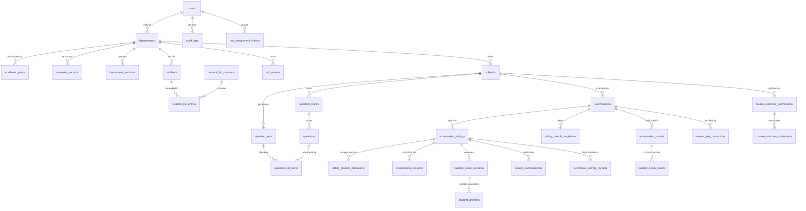

# MIT Mysore Examination Management System (EMS)
## Unified PostgreSQL Database Schema Specification

**System Version:** 1.0.0  
**Target RDBMS:** PostgreSQL 15+  
**Architecture:** Single Shared Central Relational Database supporting Admin Portal, COE Portal, and Isolated Lab Server / Student Portal  
**Target Path:** `c:\Users\Dhanush K N\Downloads\ALL 3 PORTALS\INTEGRATION\DATABASE_SCHEMA.md`

---

## 1. Architectural Overview & Invariants

This schema document provides the authoritative PostgreSQL schema for the unified MIT Mysore Examination Management System. All three portals—**Admin Portal (Principal & HOD)**, **COE Portal (Controller of Examinations)**, and **Student Portal (CBT Examination & Lab Recovery)**—interact with this common data model (or its local synchronised replica on the Lab Server).

### 1.1 Core Architectural Invariants

1. **Zero Advance Workstation Preassignment:**
   Physical PC / workstation numbers are **never** assigned to candidates in advance during exam scheduling or sitting generation. The `sitting_student_allocations` table assigns candidate USNs to paper versions ($A, B, C, D$) and sitting slots ($Morning / Afternoon$), while the runtime workstation binding is established dynamically upon candidate login via `student_exam_sessions.pc_number`.

2. **Independent Sitting Lifecycle & Cryptographic Packages:**
   Morning and Afternoon examination sittings are represented as distinct rows in `examination_sittings`. Each sitting possesses an independent question set selection (`selected_set_id`), cryptographic package payload (`package_id`, `package_revision`), digital signature, unlock verifier, and final `.labresult` archive.

3. **Strict Salted Verifier Storage for Security Credentials:**
   Plaintext invigilator passwords or recovery credentials must never be persisted in PostgreSQL. Session unlock credentials store salted `SHA256-ITER-V1` or PBKDF2 hashes (`salt`, `verifier_hash`, `verifier_scheme`, `masked_preview`), ensuring offline verification capability on isolated Lab Servers without exposing secrets in databases or frontend code.

4. **Confidentiality & Role Separation:**
   - **HOD Portal:** Restricted to candidate roster uploads, question bank authoring, blueprint definitions, subject setups, Course Outcome syllabus submissions, and post-release result views with answer-key correction requests. HODs cannot see generated student paper versions or question allocations.
   - **COE Portal:** Sole authority over examination scheduling, sitting creation, question set selection, version shuffle generation, LAN package distribution, unlock credential generation, result import verification, answer key correction adjudication, and institutional result release.
   - **Student Portal:** Candidate client exclusively receives question statements and shuffled options for their assigned version. Answer keys and grading parameters are strictly stripped by backend/Lab Server endpoints.

5. **Immutable Audit Trails & Revision Invalidation:**
   Edits to an examination with already-transferred packages automatically increment `revision_number`, invalidate previous package hashes (`transfer_status = 'Not Sent'`), and record changes in `audit_logs`. Completed and Cancelled examinations cannot be deleted (`DELETE` rejected by database rules).

---

## 2. The 5 Cross-Portal System Connections

Every table in this schema is explicitly mapped to one or more of the five foundational cross-portal data connections:

| Connection ID | Direction | Functional Flow | Key PostgreSQL Tables |
|:---|:---|:---|:---|
| **CONNECTION 1** | **COE $\rightarrow$ Admin (HOD)** | Examination Scheduling Visibility. COE schedules an examination; HOD monitors upcoming exam dates, sittings, and lab assignments for their department. | `examinations`, `examination_sittings`, `subjects`, `departments` |
| **CONNECTION 2** | **Admin (HOD) $\rightarrow$ COE** | Candidate Eligibility & Question Sets. HOD uploads candidate rosters and publishes question sets; COE views authoritative eligibility rosters and selects published sets for sittings. | `students`, `student_list_revisions`, `student_list_entries`, `question_banks`, `questions`, `question_sets`, `question_set_items` |
| **CONNECTION 3** | **COE $\rightarrow$ Student / Lab** | Sitting Packages & Session Initialization. COE selects sets, generates balanced $A/B/C/D$ versions, bundles workstations, and transfers signed packages to Lab Server; candidates log in and receive their assigned paper version. | `examination_sittings`, `sitting_student_allocations`, `sitting_unlock_credentials`, `lab_servers`, `examination_sessions` |
| **CONNECTION 4** | **Student $\rightarrow$ COE / Lab** | Exam Execution, Proctoring & Result Gathering. Students submit answers, security events lock terminals, invigilators unlock/rebind, and completed sitting records are packaged into `.labresult` archives. | `student_exam_sessions`, `student_answers`, `suspicious_activity_records`, `relogin_authorisations`, `examination_sessions` |
| **CONNECTION 5** | **COE $\rightarrow$ Admin (HOD & Principal)** | Result Verification, Release & Key Corrections. COE verifies `.labresult` archives and imports scores. HOD inspects scores and submits answer-key corrections; COE approves/recalculates; COE releases final scores to HOD & Principal. | `examination_results`, `student_exam_results`, `answer_key_corrections`, `course_outcome_submissions`, `audit_logs` |

---

## 3. Simplified Entity-Relationship Diagram (ERD)



---

## 4. PostgreSQL DDL: Core Domain Tables (1 to 13)

### Table 1: `users`
**Purpose:** Central authentication, RBAC identity, and employee profile directory for all institutional actors across the three portals.  
**Portals Using Table:** Admin Portal (Principal, HOD), COE Portal (COE, Staff), Student Portal (Invigilator / Instructor authentication).  
**Connection Enabled:** Foundational identity provider for **Connections 1 through 5**.

```sql
CREATE TABLE users (
    id VARCHAR(36) PRIMARY KEY,
    employee_id VARCHAR(50) UNIQUE NOT NULL,
    full_name VARCHAR(150) NOT NULL,
    email VARCHAR(255) UNIQUE NOT NULL,
    username VARCHAR(50) UNIQUE NOT NULL,
    password_hash VARCHAR(255) NOT NULL,
    role VARCHAR(20) NOT NULL CHECK (role IN ('PRINCIPAL', 'HOD', 'COE', 'STUDENT', 'INVIGILATOR', 'SYSTEM')),
    designation VARCHAR(100),
    department_id VARCHAR(36),
    contact_number VARCHAR(20),
    last_login_at TIMESTAMPTZ,
    theme_preference VARCHAR(10) NOT NULL DEFAULT 'light' CHECK (theme_preference IN ('light', 'dark')),
    account_status VARCHAR(20) NOT NULL DEFAULT 'Active' CHECK (account_status IN ('Active', 'Inactive', 'Suspended')),
    created_at TIMESTAMPTZ NOT NULL DEFAULT CURRENT_TIMESTAMP,
    updated_at TIMESTAMPTZ NOT NULL DEFAULT CURRENT_TIMESTAMP
);

CREATE INDEX idx_users_username ON users(username);
CREATE INDEX idx_users_email ON users(email);
CREATE INDEX idx_users_role ON users(role);
CREATE INDEX idx_users_dept ON users(department_id);
```

---

### Table 2: `departments`
**Purpose:** Academic engineering departments and administrative faculties in MIT Mysore.  
**Portals Using Table:** Admin Portal (Principal creates/updates depts, assigns HOD), COE Portal (Filters schedules, eligibility, and subjects by department).  
**Connection Enabled:** **Connection 1, Connection 2, Connection 5**.

```sql
CREATE TABLE departments (
    id VARCHAR(36) PRIMARY KEY,
    code VARCHAR(10) UNIQUE NOT NULL, -- e.g., 'CSE', 'ISE', 'ECE', 'AIML', 'ME', 'CV'
    name VARCHAR(150) NOT NULL,
    identification_number VARCHAR(50),
    hod_id VARCHAR(36) REFERENCES users(id) ON DELETE SET NULL,
    status VARCHAR(20) NOT NULL DEFAULT 'Active' CHECK (status IN ('Active', 'Inactive')),
    created_at TIMESTAMPTZ NOT NULL DEFAULT CURRENT_TIMESTAMP,
    updated_at TIMESTAMPTZ NOT NULL DEFAULT CURRENT_TIMESTAMP
);

ALTER TABLE users ADD CONSTRAINT fk_users_department FOREIGN KEY (department_id) REFERENCES departments(id) ON DELETE SET NULL;

CREATE INDEX idx_departments_code ON departments(code);
CREATE INDEX idx_departments_status ON departments(status);
```

---

### Table 3: `academic_years`
**Purpose:** Academic year timelines and operational calendar scopes.  
**Portals Using Table:** Admin Portal (Student roster and subject context), COE Portal (Examination cycle scheduling).  
**Connection Enabled:** **Connection 1, Connection 2, Connection 5**.

```sql
CREATE TABLE academic_years (
    id VARCHAR(36) PRIMARY KEY,
    label VARCHAR(50) NOT NULL, -- e.g., '2025-2026'
    start_year INT NOT NULL,
    end_year INT NOT NULL,
    is_current BOOLEAN NOT NULL DEFAULT false,
    status VARCHAR(20) NOT NULL DEFAULT 'Active' CHECK (status IN ('Active', 'Upcoming', 'Archived')),
    created_at TIMESTAMPTZ NOT NULL DEFAULT CURRENT_TIMESTAMP
);

CREATE UNIQUE INDEX idx_academic_years_unique_label ON academic_years(label);
CREATE INDEX idx_academic_years_current ON academic_years(is_current) WHERE is_current = true;
```

---

### Table 4: `semester_records`
**Purpose:** Fixed semester enumerations ($1^{\text{st}}$ through $8^{\text{th}}$) tied to institutional departments and academic years.  
**Portals Using Table:** Admin Portal (HOD curriculum organization), COE Portal (Exam semester targets), Student Portal (Candidate semester display).  
**Connection Enabled:** **Connection 1, Connection 2, Connection 3**.

```sql
CREATE TABLE semester_records (
    id VARCHAR(36) PRIMARY KEY,
    semester_number INT NOT NULL CHECK (semester_number BETWEEN 1 AND 8),
    label VARCHAR(50) NOT NULL, -- e.g., '5th Semester'
    short_label VARCHAR(20) NOT NULL, -- e.g., '5th'
    department_id VARCHAR(36) REFERENCES departments(id) ON DELETE CASCADE,
    academic_year_id VARCHAR(36) REFERENCES academic_years(id) ON DELETE CASCADE,
    status VARCHAR(20) NOT NULL DEFAULT 'Active' CHECK (status IN ('Active', 'Upcoming', 'Completed')),
    created_at TIMESTAMPTZ NOT NULL DEFAULT CURRENT_TIMESTAMP,
    CONSTRAINT uq_dept_year_semester UNIQUE (department_id, academic_year_id, semester_number)
);

CREATE INDEX idx_semester_records_dept_sem ON semester_records(department_id, semester_number);
```

---

### Table 5: `department_sections`
**Purpose:** Departmental class division configurations (e.g., Section A, Section B).  
**Portals Using Table:** Admin Portal (HOD adds sections to semesters), COE Portal (Combined section exam planning).  
**Connection Enabled:** **Connection 1, Connection 2**.

```sql
CREATE TABLE department_sections (
    id VARCHAR(36) PRIMARY KEY,
    department_id VARCHAR(36) NOT NULL REFERENCES departments(id) ON DELETE CASCADE,
    semester_number INT NOT NULL CHECK (semester_number BETWEEN 1 AND 8),
    name VARCHAR(10) NOT NULL, -- e.g., 'A', 'B', 'C'
    created_at TIMESTAMPTZ NOT NULL DEFAULT CURRENT_TIMESTAMP,
    CONSTRAINT uq_dept_sem_sec UNIQUE (department_id, semester_number, name)
);

CREATE INDEX idx_dept_sections_lookup ON department_sections(department_id, semester_number);
```

---

### Table 6: `students`
**Purpose:** Master candidate directory containing University Seat Numbers (USN), sensitive dates of birth, and enrollment parameters.  
**Portals Using Table:** Admin Portal (HOD student roster setup), COE Portal (Authoritative candidate eligibility snapshot), Student Portal (Candidate login credential check).  
**Connection Enabled:** **Connection 2, Connection 3, Connection 4, Connection 5**.

```sql
CREATE TABLE students (
    id VARCHAR(36) PRIMARY KEY,
    usn VARCHAR(20) UNIQUE NOT NULL, -- e.g., '4MH25CS149'
    full_name VARCHAR(150) NOT NULL,
    dob DATE NOT NULL, -- Sensitive: verified at student login
    department_id VARCHAR(36) NOT NULL REFERENCES departments(id) ON DELETE RESTRICT,
    semester_number INT NOT NULL CHECK (semester_number BETWEEN 1 AND 8),
    section VARCHAR(10) NOT NULL,
    is_eligible BOOLEAN NOT NULL DEFAULT true,
    enrollment_status VARCHAR(20) NOT NULL DEFAULT 'Enrolled' CHECK (enrollment_status IN ('Enrolled', 'Graduated', 'Discontinued')),
    created_at TIMESTAMPTZ NOT NULL DEFAULT CURRENT_TIMESTAMP,
    updated_at TIMESTAMPTZ NOT NULL DEFAULT CURRENT_TIMESTAMP
);

CREATE INDEX idx_students_usn ON students(usn);
CREATE INDEX idx_students_dept_sem_sec ON students(department_id, semester_number, section);
CREATE INDEX idx_students_eligibility ON students(department_id, semester_number, is_eligible);
```

---

### Table 7: `student_list_revisions`
**Purpose:** Historical audit revisions of class student rosters uploaded by HODs (via Excel/PDF).  
**Portals Using Table:** Admin Portal (Roster version tracking and replacement), COE Portal (Verification of frozen candidate rosters).  
**Connection Enabled:** **Connection 2**.

```sql
CREATE TABLE student_list_revisions (
    id VARCHAR(36) PRIMARY KEY,
    department_id VARCHAR(36) NOT NULL REFERENCES departments(id) ON DELETE CASCADE,
    academic_year_id VARCHAR(36) NOT NULL REFERENCES academic_years(id) ON DELETE RESTRICT,
    semester_number INT NOT NULL CHECK (semester_number BETWEEN 1 AND 8),
    section VARCHAR(10) NOT NULL,
    file_name VARCHAR(255),
    source_type VARCHAR(50) NOT NULL CHECK (source_type IN ('EXCEL_UPLOAD', 'MANUAL_ENTRY', 'PDF_CONVERTED_EXCEL')),
    revision_number VARCHAR(20) NOT NULL, -- e.g., 'REV-01'
    total_students INT NOT NULL DEFAULT 0,
    valid_count INT NOT NULL DEFAULT 0,
    invalid_count INT NOT NULL DEFAULT 0,
    status VARCHAR(50) NOT NULL DEFAULT 'Active' CHECK (status IN ('Active', 'Replaced', 'Frozen by COE')),
    uploaded_by VARCHAR(36) NOT NULL REFERENCES users(id) ON DELETE RESTRICT,
    created_at TIMESTAMPTZ NOT NULL DEFAULT CURRENT_TIMESTAMP
);

CREATE INDEX idx_student_list_revisions_lookup ON student_list_revisions(department_id, semester_number, section, status);
```

---

### Table 8: `student_list_entries`
**Purpose:** Granular row-by-row candidate records parsed from HOD roster revisions with validation flags.  
**Portals Using Table:** Admin Portal (In-line data table validation, error correction preview).  
**Connection Enabled:** **Connection 2**.

```sql
CREATE TABLE student_list_entries (
    id VARCHAR(36) PRIMARY KEY,
    revision_id VARCHAR(36) NOT NULL REFERENCES student_list_revisions(id) ON DELETE CASCADE,
    student_id VARCHAR(36) NOT NULL REFERENCES students(id) ON DELETE CASCADE,
    row_number INT NOT NULL,
    is_valid BOOLEAN NOT NULL DEFAULT true,
    validation_errors JSONB DEFAULT '[]'::jsonb,
    created_at TIMESTAMPTZ NOT NULL DEFAULT CURRENT_TIMESTAMP
);

CREATE INDEX idx_student_list_entries_rev ON student_list_entries(revision_id);
CREATE INDEX idx_student_list_entries_student ON student_list_entries(student_id);
```

---

### Table 9: `subjects`
**Purpose:** Course subject registry including examination parameters, module count, and HOD publication flags.  
**Portals Using Table:** Admin Portal (HOD registers and configures subjects), COE Portal (COE schedules examinations for published subjects), Student Portal (Subject details).  
**Connection Enabled:** **Connection 1, Connection 2, Connection 3**.

```sql
CREATE TABLE subjects (
    id VARCHAR(36) PRIMARY KEY,
    code VARCHAR(20) NOT NULL, -- e.g., 'BCS501'
    name VARCHAR(150) NOT NULL,
    department_id VARCHAR(36) NOT NULL REFERENCES departments(id) ON DELETE RESTRICT,
    semester_number INT NOT NULL CHECK (semester_number BETWEEN 1 AND 8),
    academic_year_id VARCHAR(36) NOT NULL REFERENCES academic_years(id) ON DELETE RESTRICT,
    module_count INT NOT NULL DEFAULT 5,
    applicable_sections JSONB NOT NULL DEFAULT '[]'::jsonb,
    marks_per_question NUMERIC(5,2) NOT NULL DEFAULT 1.00,
    question_count_per_set INT NOT NULL DEFAULT 30,
    maximum_marks NUMERIC(5,2) NOT NULL DEFAULT 30.00,
    status VARCHAR(20) NOT NULL DEFAULT 'Active' CHECK (status IN ('Active', 'Archived', 'Inactive')),
    hod_published BOOLEAN NOT NULL DEFAULT false,
    published_at TIMESTAMPTZ,
    created_at TIMESTAMPTZ NOT NULL DEFAULT CURRENT_TIMESTAMP,
    updated_at TIMESTAMPTZ NOT NULL DEFAULT CURRENT_TIMESTAMP,
    CONSTRAINT uq_subject_code_dept_year UNIQUE (code, department_id, academic_year_id)
);

CREATE INDEX idx_subjects_dept_sem ON subjects(department_id, semester_number);
CREATE INDEX idx_subjects_published ON subjects(hod_published) WHERE hod_published = true;
```

---

### Table 10: `question_banks`
**Purpose:** Raw question bank file repositories uploaded by HODs prior to set generation.  
**Portals Using Table:** Admin Portal (HOD question upload, parsing status).  
**Connection Enabled:** **Connection 2**.

```sql
CREATE TABLE question_banks (
    id VARCHAR(36) PRIMARY KEY,
    subject_id VARCHAR(36) NOT NULL REFERENCES subjects(id) ON DELETE CASCADE,
    revision_id VARCHAR(50) NOT NULL, -- e.g., 'QBR-2026-01'
    file_name VARCHAR(255) NOT NULL,
    source_type VARCHAR(50) NOT NULL CHECK (source_type IN ('EXCEL_UPLOAD', 'PDF_CONVERTED', 'DOCX_CONVERTED')),
    total_questions INT NOT NULL DEFAULT 0,
    status VARCHAR(50) NOT NULL DEFAULT 'Draft' CHECK (status IN ('Draft', 'Processing', 'Validated', 'Archived')),
    uploaded_by VARCHAR(36) NOT NULL REFERENCES users(id) ON DELETE RESTRICT,
    created_at TIMESTAMPTZ NOT NULL DEFAULT CURRENT_TIMESTAMP
);

CREATE INDEX idx_question_banks_subject ON question_banks(subject_id);
```

---

### Table 11: `questions`
**Purpose:** Stable individual question items with module associations, rich options, embedded base64/URI image assets, and authoritative answer keys.  
**Portals Using Table:** Admin Portal (HOD reviews questions), COE Portal (Item pool for shuffling), Lab Server / Student Portal (Delivers question body and options; **correct_answer is stripped**).  
**Connection Enabled:** **Connection 2, Connection 3, Connection 4, Connection 5**.

```sql
CREATE TABLE questions (
    id VARCHAR(36) PRIMARY KEY, -- Stable Question ID retained across revisions and A-D shuffled versions
    question_bank_id VARCHAR(36) NOT NULL REFERENCES question_banks(id) ON DELETE CASCADE,
    subject_id VARCHAR(36) NOT NULL REFERENCES subjects(id) ON DELETE CASCADE,
    question_number INT,
    module_number INT NOT NULL,
    text TEXT NOT NULL,
    option_a TEXT NOT NULL,
    option_b TEXT NOT NULL,
    option_c TEXT NOT NULL,
    option_d TEXT NOT NULL,
    correct_answer VARCHAR(5) NOT NULL CHECK (correct_answer IN ('A', 'B', 'C', 'D')),
    marks NUMERIC(4,2) NOT NULL DEFAULT 1.00,
    images JSONB DEFAULT '[]'::jsonb, -- QuestionImageAsset array (base64, targetField, sequence)
    status VARCHAR(20) NOT NULL DEFAULT 'Active' CHECK (status IN ('Active', 'Archived')),
    created_at TIMESTAMPTZ NOT NULL DEFAULT CURRENT_TIMESTAMP,
    updated_at TIMESTAMPTZ NOT NULL DEFAULT CURRENT_TIMESTAMP
);

CREATE INDEX idx_questions_bank ON questions(question_bank_id);
CREATE INDEX idx_questions_subject_module ON questions(subject_id, module_number);
```

---

### Table 12: `question_sets`
**Purpose:** Formally generated, numbered question sets ($Set\ 1, Set\ 2, \dots$) created according to blueprint module distributions.  
**Portals Using Table:** Admin Portal (HOD generates and publishes numbered sets), COE Portal (COE views set metadata and selects sets for examination sittings).  
**Connection Enabled:** **Connection 2, Connection 3**.

```sql
CREATE TABLE question_sets (
    id VARCHAR(36) PRIMARY KEY,
    subject_id VARCHAR(36) NOT NULL REFERENCES subjects(id) ON DELETE CASCADE,
    set_number VARCHAR(50) NOT NULL, -- e.g., 'Set 1', 'Set 2'
    revision_id VARCHAR(50),
    blueprint_revision_id VARCHAR(50),
    is_active BOOLEAN NOT NULL DEFAULT true,
    publication_status VARCHAR(50) NOT NULL DEFAULT 'Not Published' 
        CHECK (publication_status IN ('Published by HOD', 'Not Published', 'Superseded')),
    number_of_questions INT NOT NULL,
    module_distribution JSONB NOT NULL DEFAULT '{}'::jsonb, -- e.g. {"1":6,"2":6,"3":6,"4":6,"5":6}
    generated_by VARCHAR(36) NOT NULL REFERENCES users(id) ON DELETE RESTRICT,
    published_at TIMESTAMPTZ,
    created_at TIMESTAMPTZ NOT NULL DEFAULT CURRENT_TIMESTAMP,
    CONSTRAINT uq_subject_set_number UNIQUE (subject_id, set_number)
);

CREATE INDEX idx_question_sets_subject ON question_sets(subject_id, publication_status);
```

---

### Table 13: `question_set_items`
**Purpose:** Join table binding stable question IDs to numbered sets in an assigned sequence.  
**Portals Using Table:** Admin Portal (Set compilation), COE Portal (Base pool from which shuffled $A/B/C/D$ versions are derived).  
**Connection Enabled:** **Connection 2, Connection 3**.

```sql
CREATE TABLE question_set_items (
    id VARCHAR(36) PRIMARY KEY,
    question_set_id VARCHAR(36) NOT NULL REFERENCES question_sets(id) ON DELETE CASCADE,
    question_id VARCHAR(36) NOT NULL REFERENCES questions(id) ON DELETE CASCADE,
    position INT NOT NULL,
    module_number INT NOT NULL,
    created_at TIMESTAMPTZ NOT NULL DEFAULT CURRENT_TIMESTAMP,
    CONSTRAINT uq_set_item UNIQUE (question_set_id, question_id)
);

CREATE INDEX idx_question_set_items_set ON question_set_items(question_set_id, position);
```

---

## 5. PostgreSQL DDL: Examination Domain Tables (14 to 17)

### Table 14: `examinations`
**Purpose:** Master examination scheduling records created by the COE, defining passing marks, exam dates, durations, and frozen candidate eligibility snapshots.  
**Portals Using Table:** COE Portal (Full lifecycle scheduling, freezing, cancelling), Admin Portal (HOD read-only inspection of departmental exams), Student Portal (Candidate exam metadata).  
**Connection Enabled:** **Connection 1 (COE $\rightarrow$ HOD), Connection 3 (COE $\rightarrow$ Student)**.

```sql
CREATE TABLE examinations (
    id VARCHAR(36) PRIMARY KEY,
    exam_code VARCHAR(50) UNIQUE NOT NULL, -- e.g., 'BCS501-NOV26'
    department_id VARCHAR(36) NOT NULL REFERENCES departments(id) ON DELETE RESTRICT,
    semester_number INT NOT NULL CHECK (semester_number BETWEEN 1 AND 8),
    combined_sections JSONB NOT NULL DEFAULT '[]'::jsonb, -- e.g., ["A", "B"]
    academic_year_id VARCHAR(36) NOT NULL REFERENCES academic_years(id) ON DELETE RESTRICT,
    subject_id VARCHAR(36) NOT NULL REFERENCES subjects(id) ON DELETE RESTRICT,
    exam_date DATE NOT NULL,
    start_time VARCHAR(20) NOT NULL, -- e.g., '09:30'
    duration_minutes INT NOT NULL CHECK (duration_minutes > 0),
    total_questions INT NOT NULL,
    marks_per_question NUMERIC(5,2) NOT NULL DEFAULT 1.00,
    maximum_marks NUMERIC(5,2) NOT NULL,
    passing_marks NUMERIC(5,2) NOT NULL,
    status VARCHAR(30) NOT NULL DEFAULT 'Scheduled' 
        CHECK (status IN ('Draft', 'Scheduled', 'In Progress', 'Exam Completed', 'Cancelled')),
    is_finalized_and_frozen BOOLEAN NOT NULL DEFAULT false,
    snapshot_id VARCHAR(50), -- Immutable snapshot identifier for frozen eligibility and paper state
    finalized_at TIMESTAMPTZ,
    finalized_by VARCHAR(36) REFERENCES users(id) ON DELETE SET NULL,
    cancellation_reason TEXT,
    cancelled_at TIMESTAMPTZ,
    cancelled_by VARCHAR(36) REFERENCES users(id) ON DELETE SET NULL,
    revision_number INT NOT NULL DEFAULT 1,
    created_by VARCHAR(36) NOT NULL REFERENCES users(id) ON DELETE RESTRICT,
    created_at TIMESTAMPTZ NOT NULL DEFAULT CURRENT_TIMESTAMP,
    updated_at TIMESTAMPTZ NOT NULL DEFAULT CURRENT_TIMESTAMP,
    CONSTRAINT chk_passing_max_marks CHECK (passing_marks <= maximum_marks)
);

CREATE INDEX idx_examinations_dept_sem ON examinations(department_id, semester_number);
CREATE INDEX idx_examinations_date_status ON examinations(exam_date, status);
CREATE INDEX idx_examinations_subject ON examinations(subject_id);
```

---

### Table 15: `examination_sittings`
**Purpose:** Distinct operational sitting sessions ($Morning\ Sitting$, $Afternoon\ Sitting$) representing lab allocations, question set selections, and LAN package status.  
**Portals Using Table:** COE Portal (Sitting allocation, question set binding, package transfer), Admin Portal (HOD sitting schedule view), Student Portal / Lab Server (Session envelope).  
**Connection Enabled:** **Connection 1, Connection 3, Connection 4**.

```sql
CREATE TABLE examination_sittings (
    id VARCHAR(36) PRIMARY KEY,
    examination_id VARCHAR(36) NOT NULL REFERENCES examinations(id) ON DELETE CASCADE,
    sitting_name VARCHAR(50) NOT NULL CHECK (sitting_name IN ('Morning Sitting', 'Afternoon Sitting')),
    exam_date DATE NOT NULL,
    start_time VARCHAR(20) NOT NULL,
    duration_minutes INT NOT NULL,
    lab_id VARCHAR(50) NOT NULL, -- References lab_servers(id)
    student_count INT NOT NULL DEFAULT 0,
    status VARCHAR(30) NOT NULL DEFAULT 'Scheduled' 
        CHECK (status IN ('Scheduled', 'In Progress', 'Exam Completed', 'Cancelled')),
    selected_set_id VARCHAR(36) REFERENCES question_sets(id) ON DELETE RESTRICT,
    package_id VARCHAR(100),
    package_revision INT NOT NULL DEFAULT 1,
    package_config_hash VARCHAR(128),
    preparation_status VARCHAR(50) NOT NULL DEFAULT 'Not Prepared'
        CHECK (preparation_status IN ('Not Prepared', 'Preparing', 'Completed', 'Failed')),
    security_status VARCHAR(50) NOT NULL DEFAULT 'Pending'
        CHECK (security_status IN ('Pending', 'Securing Package', 'Package Secured', 'Failed')),
    transfer_status VARCHAR(50) NOT NULL DEFAULT 'Not Sent'
        CHECK (transfer_status IN ('Not Sent', 'Sending', 'Received', 'Transfer Failed', 'Interrupted')),
    verification_readiness_status VARCHAR(50) NOT NULL DEFAULT 'Verification Pending'
        CHECK (verification_readiness_status IN ('Verification Pending', 'Verifying', 'Verified', 'Rejected', 'Ready for Examination')),
    is_enabled BOOLEAN NOT NULL DEFAULT true,
    versions_generated BOOLEAN NOT NULL DEFAULT false,
    created_at TIMESTAMPTZ NOT NULL DEFAULT CURRENT_TIMESTAMP,
    updated_at TIMESTAMPTZ NOT NULL DEFAULT CURRENT_TIMESTAMP,
    CONSTRAINT uq_exam_sitting UNIQUE (examination_id, sitting_name)
);

CREATE INDEX idx_examination_sittings_exam ON examination_sittings(examination_id);
CREATE INDEX idx_examination_sittings_lab ON examination_sittings(lab_id, exam_date);
```

---

### Table 16: `sitting_student_allocations`
**Purpose:** Pre-exam balanced allocation of candidate USNs to paper versions ($A, B, C, D$) and selected question sets. Physical workstations are **strictly unassigned** until dynamic runtime login.  
**Portals Using Table:** COE Portal (Generates balanced versions; confidential to COE), Lab Server / Student Portal (Authoritative version lookup upon candidate authentication).  
**Connection Enabled:** **Connection 3 (COE $\rightarrow$ Lab/Student), Connection 4 (Student Login)**.

```sql
CREATE TABLE sitting_student_allocations (
    id VARCHAR(36) PRIMARY KEY,
    sitting_id VARCHAR(36) NOT NULL REFERENCES examination_sittings(id) ON DELETE CASCADE,
    student_id VARCHAR(36) NOT NULL REFERENCES students(id) ON DELETE RESTRICT,
    usn VARCHAR(20) NOT NULL,
    version_letter VARCHAR(1) NOT NULL CHECK (version_letter IN ('A', 'B', 'C', 'D')),
    assigned_set_id VARCHAR(36) NOT NULL REFERENCES question_sets(id) ON DELETE RESTRICT,
    allocation_revision INT NOT NULL DEFAULT 1,
    workstation_id VARCHAR(50), -- Invariant: NULL in advance; set ONLY on dynamic login via student_exam_sessions
    status VARCHAR(20) NOT NULL DEFAULT 'Assigned' CHECK (status IN ('Assigned', 'Reallocated')),
    created_at TIMESTAMPTZ NOT NULL DEFAULT CURRENT_TIMESTAMP,
    CONSTRAINT uq_sitting_student UNIQUE (sitting_id, student_id),
    CONSTRAINT uq_sitting_usn UNIQUE (sitting_id, usn)
);

CREATE INDEX idx_sitting_student_alloc_sitting ON sitting_student_allocations(sitting_id);
CREATE INDEX idx_sitting_student_alloc_usn ON sitting_student_allocations(usn);
```

---

### Table 17: `sitting_unlock_credentials`
**Purpose:** Session-specific invigilator unlock credentials for offline lockout resumption, storing strictly salted hashes (`SHA256-ITER-V1`) without storing plaintext passwords.  
**Portals Using Table:** COE Portal (Generates secret and sends salted verifier metadata to Lab Server), Lab Server / Student Portal (Offline verification of room invigilator passwords).  
**Connection Enabled:** **Connection 3 (COE $\rightarrow$ Lab), Connection 4 (Invigilator Lock Resumption)**.

```sql
CREATE TABLE sitting_unlock_credentials (
    id VARCHAR(36) PRIMARY KEY,
    examination_id VARCHAR(36) NOT NULL REFERENCES examinations(id) ON DELETE CASCADE,
    sitting_id VARCHAR(36) NOT NULL REFERENCES examination_sittings(id) ON DELETE CASCADE,
    credential_id VARCHAR(50) UNIQUE NOT NULL, -- e.g., 'UNLK-2026-001-AM'
    revision INT NOT NULL DEFAULT 1,
    salt VARCHAR(128) NOT NULL,
    verifier_hash VARCHAR(256) NOT NULL,
    verifier_scheme VARCHAR(50) NOT NULL DEFAULT 'SHA256-ITER-V1',
    masked_preview VARCHAR(50) NOT NULL, -- e.g., 'MITM-••••-8F3K'
    expires_at TIMESTAMPTZ NOT NULL,
    status VARCHAR(30) NOT NULL DEFAULT 'Active' 
        CHECK (status IN ('Not Generated', 'Active', 'Expired', 'Revoked', 'Synchronisation Pending', 'Synchronisation Failed')),
    sync_status VARCHAR(30) NOT NULL DEFAULT 'Not Synced' 
        CHECK (sync_status IN ('Not Synced', 'Synced', 'Sync Pending', 'Sync Failed')),
    last_synced_at TIMESTAMPTZ,
    created_by VARCHAR(36) NOT NULL REFERENCES users(id) ON DELETE RESTRICT,
    created_at TIMESTAMPTZ NOT NULL DEFAULT CURRENT_TIMESTAMP,
    updated_at TIMESTAMPTZ NOT NULL DEFAULT CURRENT_TIMESTAMP
);

CREATE INDEX idx_unlock_cred_sitting ON sitting_unlock_credentials(sitting_id, status);
```

---

## 6. PostgreSQL DDL: Session & Lab Server Domain Tables (18 to 21)

### Table 18: `lab_servers`
**Purpose:** College computing laboratory servers, IP addresses, capacities, connection states, and registered workstation physical endpoints.  
**Portals Using Table:** COE Portal (Lab booking capacity verification, telemetry polling, package dispatch).  
**Connection Enabled:** **Connection 3, Connection 4**.

```sql
CREATE TABLE lab_servers (
    id VARCHAR(50) PRIMARY KEY, -- e.g., 'LAB-CSE-01'
    lab_name VARCHAR(150) NOT NULL,
    server_identifier VARCHAR(100) UNIQUE NOT NULL,
    department_id VARCHAR(36) REFERENCES departments(id) ON DELETE SET NULL,
    capacity INT NOT NULL CHECK (capacity > 0),
    connection_status VARCHAR(20) NOT NULL DEFAULT 'Connected' CHECK (connection_status IN ('Connected', 'Disconnected')),
    api_base_url VARCHAR(255), -- e.g., 'http://192.168.10.50:8443/lab-api/v1'
    registered_workstation_ids JSONB NOT NULL DEFAULT '[]'::jsonb, -- Array of workstation IDs: ["LAB01-PC-01", ...]
    created_at TIMESTAMPTZ NOT NULL DEFAULT CURRENT_TIMESTAMP,
    updated_at TIMESTAMPTZ NOT NULL DEFAULT CURRENT_TIMESTAMP
);

ALTER TABLE examination_sittings ADD CONSTRAINT fk_sittings_lab FOREIGN KEY (lab_id) REFERENCES lab_servers(id) ON DELETE RESTRICT;

CREATE INDEX idx_lab_servers_dept ON lab_servers(department_id);
```

---

### Table 19: `examination_sessions`
**Purpose:** Real-time laboratory session orchestration container tracking attendance, live counts, elapsed time, and security metrics during an active sitting.  
**Portals Using Table:** Lab Server (Local runtime session management), COE Portal (Telemetry aggregation dashboard).  
**Connection Enabled:** **Connection 3, Connection 4**.

```sql
CREATE TABLE examination_sessions (
    id VARCHAR(36) PRIMARY KEY,
    examination_id VARCHAR(36) NOT NULL REFERENCES examinations(id) ON DELETE CASCADE,
    sitting_id VARCHAR(36) NOT NULL REFERENCES examination_sittings(id) ON DELETE CASCADE,
    session_id VARCHAR(100) UNIQUE NOT NULL, -- e.g., 'SES-CSE-5A-BCS501-MORN'
    lab_id VARCHAR(50) NOT NULL REFERENCES lab_servers(id) ON DELETE RESTRICT,
    session_status VARCHAR(30) NOT NULL DEFAULT 'Ready' 
        CHECK (session_status IN ('Ready', 'Active', 'Completed', 'Interrupted')),
    total_eligible_students INT NOT NULL DEFAULT 0,
    students_logged_in INT NOT NULL DEFAULT 0,
    students_started INT NOT NULL DEFAULT 0,
    students_submitted INT NOT NULL DEFAULT 0,
    students_absent INT NOT NULL DEFAULT 0,
    active_lab_computers INT NOT NULL DEFAULT 0,
    total_suspicious_events INT NOT NULL DEFAULT 0,
    locked_students_count INT NOT NULL DEFAULT 0,
    invigilator_unlock_count INT NOT NULL DEFAULT 0,
    pc_recovery_count INT NOT NULL DEFAULT 0,
    start_time TIMESTAMPTZ,
    end_time TIMESTAMPTZ,
    remaining_time VARCHAR(50),
    last_synced_at TIMESTAMPTZ,
    created_at TIMESTAMPTZ NOT NULL DEFAULT CURRENT_TIMESTAMP,
    updated_at TIMESTAMPTZ NOT NULL DEFAULT CURRENT_TIMESTAMP
);

CREATE INDEX idx_exam_sessions_sitting ON examination_sessions(sitting_id);
CREATE INDEX idx_exam_sessions_status ON examination_sessions(session_status);
```

---

### Table 20: `student_exam_sessions`
**Purpose:** Runtime examination state per student, recording dynamic workstation binding, remaining timer seconds, proctoring lock states, and submission receipts.  
**Portals Using Table:** Student Portal (Live client heartbeat and countdown), Lab Server (Runtime state persistence), COE Portal (Live candidate grid).  
**Connection Enabled:** **Connection 3, Connection 4**.

```sql
CREATE TABLE student_exam_sessions (
    id VARCHAR(36) PRIMARY KEY,
    sitting_id VARCHAR(36) NOT NULL REFERENCES examination_sittings(id) ON DELETE CASCADE,
    session_id VARCHAR(36) NOT NULL REFERENCES examination_sessions(id) ON DELETE CASCADE,
    student_id VARCHAR(36) NOT NULL REFERENCES students(id) ON DELETE RESTRICT,
    usn VARCHAR(20) NOT NULL,
    pc_number VARCHAR(50), -- Runtime dynamically bound workstation ID (e.g. 'LAB01-PC-03')
    binding_token_id VARCHAR(100),
    login_time TIMESTAMPTZ,
    submission_time TIMESTAMPTZ,
    session_status VARCHAR(40) NOT NULL DEFAULT 'Not Started' 
        CHECK (session_status IN ('Not Started', 'In Progress', 'Locked (Suspicious Event)', 'Submitted', 'Interrupted')),
    current_question_index INT NOT NULL DEFAULT 0,
    answered_count INT NOT NULL DEFAULT 0,
    remaining_seconds INT NOT NULL,
    is_locked BOOLEAN NOT NULL DEFAULT false,
    violation_count INT NOT NULL DEFAULT 0,
    is_permanently_locked BOOLEAN NOT NULL DEFAULT false,
    locked_at TIMESTAMPTZ,
    instructions_confirmed BOOLEAN NOT NULL DEFAULT false,
    exam_started BOOLEAN NOT NULL DEFAULT false,
    exam_expires_at TIMESTAMPTZ,
    submission_trigger VARCHAR(30) CHECK (submission_trigger IN ('MANUAL', 'AUTO_TIMER_EXPIRED')),
    confirmation_reference VARCHAR(100), -- Official receipt code (e.g. 'MIT-CBT-2026-9F7A2B')
    created_at TIMESTAMPTZ NOT NULL DEFAULT CURRENT_TIMESTAMP,
    updated_at TIMESTAMPTZ NOT NULL DEFAULT CURRENT_TIMESTAMP,
    CONSTRAINT uq_sitting_student_session UNIQUE (sitting_id, student_id)
);

CREATE INDEX idx_student_exam_sessions_lookup ON student_exam_sessions(sitting_id, usn);
CREATE INDEX idx_student_exam_sessions_pc ON student_exam_sessions(sitting_id, pc_number);
```

---

### Table 21: `student_answers`
**Purpose:** Real-time autosaved student MCQ option selections and review markings during exam execution.  
**Portals Using Table:** Student Portal (Autosave endpoint `POST /api/student/exam/answers`), Lab Server (Runtime response cache & grading).  
**Connection Enabled:** **Connection 4 (Student Execution $\rightarrow$ Lab Result Processing)**.

```sql
CREATE TABLE student_answers (
    id VARCHAR(36) PRIMARY KEY,
    student_exam_session_id VARCHAR(36) NOT NULL REFERENCES student_exam_sessions(id) ON DELETE CASCADE,
    question_id VARCHAR(36) NOT NULL REFERENCES questions(id) ON DELETE RESTRICT,
    selected_option VARCHAR(5) CHECK (selected_option IN ('A', 'B', 'C', 'D')), -- NULL indicates cleared selection
    marked_for_review BOOLEAN NOT NULL DEFAULT false,
    visited BOOLEAN NOT NULL DEFAULT true,
    client_sequence INT NOT NULL DEFAULT 1,
    saved_at TIMESTAMPTZ NOT NULL DEFAULT CURRENT_TIMESTAMP,
    CONSTRAINT uq_session_question_ans UNIQUE (student_exam_session_id, question_id)
);

CREATE INDEX idx_student_answers_session ON student_answers(student_exam_session_id);
```

---

## 7. PostgreSQL DDL: Results & Evaluation Domain Tables (22 to 24)

### Table 22: `examination_results`
**Purpose:** Official sitting result packages verified and imported from `.labresult` archives, tracking COE approval and release status.  
**Portals Using Table:** COE Portal (Uploads `.labresult`, inspects verification checklist, approves and releases), Admin Portal (HOD checks if results are released).  
**Connection Enabled:** **Connection 4 (Lab $\rightarrow$ COE Result Transfer), Connection 5 (COE $\rightarrow$ HOD Result Release)**.

```sql
CREATE TABLE examination_results (
    id VARCHAR(36) PRIMARY KEY,
    examination_id VARCHAR(36) NOT NULL REFERENCES examinations(id) ON DELETE RESTRICT,
    sitting_id VARCHAR(36) NOT NULL REFERENCES examination_sittings(id) ON DELETE RESTRICT,
    sitting_name VARCHAR(50) NOT NULL,
    package_id VARCHAR(100) NOT NULL,
    import_reference_id VARCHAR(100) UNIQUE NOT NULL, -- e.g., 'IMP-2026-BCS501-MORN-8941'
    import_status VARCHAR(50) NOT NULL DEFAULT 'Not Imported' 
        CHECK (import_status IN ('Not Imported', 'Awaiting COE Approval', 'Correction Pending', 'Released')),
    imported_at TIMESTAMPTZ NOT NULL DEFAULT CURRENT_TIMESTAMP,
    imported_by VARCHAR(36) NOT NULL REFERENCES users(id) ON DELETE RESTRICT,
    approval_status VARCHAR(50) NOT NULL DEFAULT 'Pending Approval' 
        CHECK (approval_status IN ('Pending Approval', 'Approved & Released')),
    approved_at TIMESTAMPTZ,
    approved_by VARCHAR(36) REFERENCES users(id) ON DELETE SET NULL,
    total_eligible_students INT NOT NULL DEFAULT 0,
    students_present INT NOT NULL DEFAULT 0,
    students_absent INT NOT NULL DEFAULT 0,
    imported_result_records INT NOT NULL DEFAULT 0,
    records_requiring_attention INT NOT NULL DEFAULT 0,
    created_at TIMESTAMPTZ NOT NULL DEFAULT CURRENT_TIMESTAMP,
    updated_at TIMESTAMPTZ NOT NULL DEFAULT CURRENT_TIMESTAMP,
    CONSTRAINT uq_exam_sitting_result UNIQUE (examination_id, sitting_id)
);

CREATE INDEX idx_examination_results_exam ON examination_results(examination_id);
CREATE INDEX idx_examination_results_approval ON examination_results(approval_status);
```

---

### Table 23: `student_exam_results`
**Purpose:** Granular candidate evaluation records containing scored marks, pass/fail status, attendance, and question-level responses.  
**Portals Using Table:** COE Portal (Imports scores, calculates rank and pass percentage), Admin Portal (HOD and Principal result reports), Student Portal (Candidate result card).  
**Connection Enabled:** **Connection 4, Connection 5**.

```sql
CREATE TABLE student_exam_results (
    id VARCHAR(36) PRIMARY KEY,
    examination_result_id VARCHAR(36) NOT NULL REFERENCES examination_results(id) ON DELETE CASCADE,
    examination_id VARCHAR(36) NOT NULL REFERENCES examinations(id) ON DELETE RESTRICT,
    student_id VARCHAR(36) NOT NULL REFERENCES students(id) ON DELETE RESTRICT,
    usn VARCHAR(20) NOT NULL,
    full_name VARCHAR(150) NOT NULL,
    section VARCHAR(10) NOT NULL,
    semester_number INT NOT NULL,
    subject_code VARCHAR(20) NOT NULL,
    subject_name VARCHAR(150) NOT NULL,
    marks_obtained NUMERIC(5,2), -- NULL if Absent
    total_marks NUMERIC(5,2) NOT NULL,
    percentage NUMERIC(5,2),
    attendance_status VARCHAR(20) NOT NULL DEFAULT 'Present' CHECK (attendance_status IN ('Present', 'Absent')),
    is_absent BOOLEAN NOT NULL DEFAULT false,
    is_pass BOOLEAN,
    rank INT,
    assigned_version VARCHAR(1) CHECK (assigned_version IN ('A', 'B', 'C', 'D')),
    workstation_id VARCHAR(50),
    submission_timestamp TIMESTAMPTZ,
    responses JSONB DEFAULT '{}'::jsonb, -- Map of questionId -> selectedOption
    created_at TIMESTAMPTZ NOT NULL DEFAULT CURRENT_TIMESTAMP,
    updated_at TIMESTAMPTZ NOT NULL DEFAULT CURRENT_TIMESTAMP,
    CONSTRAINT uq_result_student UNIQUE (examination_result_id, student_id)
);

CREATE INDEX idx_student_exam_results_exam ON student_exam_results(examination_id);
CREATE INDEX idx_student_exam_results_usn ON student_exam_results(usn);
CREATE INDEX idx_student_exam_results_rank ON student_exam_results(examination_id, rank);
```

---

### Table 24: `answer_key_corrections`
**Purpose:** Formal question answer-key dispute workflow initiated by HODs and adjudicated by the COE, triggering automatic candidate grade recalculation upon approval.  
**Portals Using Table:** Admin Portal (HOD submits dispute with evidence), COE Portal (COE reviews, approves/rejects, recalculates scores).  
**Connection Enabled:** **Connection 5 (HOD $\leftrightarrow$ COE Answer-Key Review)**.

```sql
CREATE TABLE answer_key_corrections (
    id VARCHAR(36) PRIMARY KEY,
    examination_id VARCHAR(36) NOT NULL REFERENCES examinations(id) ON DELETE RESTRICT,
    sitting_name VARCHAR(50),
    question_id VARCHAR(36) NOT NULL REFERENCES questions(id) ON DELETE RESTRICT,
    original_answer VARCHAR(10) NOT NULL,
    corrected_answer VARCHAR(10) NOT NULL,
    reason TEXT NOT NULL,
    evidence_file_name VARCHAR(255),
    requested_by VARCHAR(36) NOT NULL REFERENCES users(id) ON DELETE RESTRICT, -- HOD
    requested_at TIMESTAMPTZ NOT NULL DEFAULT CURRENT_TIMESTAMP,
    coe_decision VARCHAR(50) NOT NULL DEFAULT 'Pending COE Review' 
        CHECK (coe_decision IN ('Pending COE Review', 'Approved & Recalculated', 'Rejected')),
    coe_decision_notes TEXT,
    decided_at TIMESTAMPTZ,
    decided_by VARCHAR(36) REFERENCES users(id) ON DELETE SET NULL, -- COE
    affected_student_usns JSONB DEFAULT '[]'::jsonb,
    recalculation_summary TEXT,
    created_at TIMESTAMPTZ NOT NULL DEFAULT CURRENT_TIMESTAMP,
    updated_at TIMESTAMPTZ NOT NULL DEFAULT CURRENT_TIMESTAMP
);

CREATE INDEX idx_key_corrections_exam ON answer_key_corrections(examination_id, coe_decision);
```

---

## 8. PostgreSQL DDL: Audit & Academic Governance Domain Tables (25 to 28)

### Table 25: `audit_logs`
**Purpose:** Immutable institutional audit trail capturing chronological actions, actors, IP addresses, and operational categories across all portals.  
**Portals Using Table:** Admin Portal (Principal & HOD audit review), COE Portal (Comprehensive examination audit view), Student Portal (Security event log).  
**Connection Enabled:** **Cross-cutting compliance & governance across all 5 Connections**.

```sql
CREATE TABLE audit_logs (
    id VARCHAR(36) PRIMARY KEY,
    actor_id VARCHAR(36) REFERENCES users(id) ON DELETE SET NULL,
    actor_name VARCHAR(150) NOT NULL,
    actor_employee_id VARCHAR(50),
    actor_role VARCHAR(30) NOT NULL CHECK (actor_role IN ('PRINCIPAL', 'HOD', 'COE', 'INVIGILATOR', 'STUDENT', 'SYSTEM')),
    category VARCHAR(50) NOT NULL, -- e.g., 'Scheduling', 'Eligibility', 'Package & Lab Transfer', 'Result & Answer-Key'
    description TEXT NOT NULL,
    target_entity VARCHAR(50),
    target_id VARCHAR(100),
    target_usn VARCHAR(20),
    department_code VARCHAR(10),
    action_status VARCHAR(30) NOT NULL DEFAULT 'Completed' 
        CHECK (action_status IN ('Completed', 'Verified', 'Warning / Locked', 'Rejected', 'Approved')),
    ip_address VARCHAR(45),
    created_at TIMESTAMPTZ NOT NULL DEFAULT CURRENT_TIMESTAMP
);

CREATE INDEX idx_audit_logs_actor ON audit_logs(actor_id);
CREATE INDEX idx_audit_logs_category_created ON audit_logs(category, created_at DESC);
CREATE INDEX idx_audit_logs_target ON audit_logs(target_entity, target_id);
```

---

### Table 26: `course_outcome_submissions`
**Purpose:** HOD-submitted Course Outcome (CO) syllabus PDF documents submitted for COE academic compliance review.  
**Portals Using Table:** Admin Portal (HOD uploads syllabus PDF and views feedback), COE Portal (COE reviews PDF and transcribes statements).  
**Connection Enabled:** **Admin (HOD) $\leftrightarrow$ COE Academic Integration**.

```sql
CREATE TABLE course_outcome_submissions (
    id VARCHAR(36) PRIMARY KEY,
    subject_id VARCHAR(36) NOT NULL REFERENCES subjects(id) ON DELETE CASCADE,
    department_id VARCHAR(36) NOT NULL REFERENCES departments(id) ON DELETE RESTRICT,
    semester_number INT NOT NULL CHECK (semester_number BETWEEN 1 AND 8),
    revision_number INT NOT NULL DEFAULT 1,
    file_name VARCHAR(255) NOT NULL,
    file_size_bytes BIGINT,
    mime_type VARCHAR(50) NOT NULL DEFAULT 'application/pdf',
    uploaded_by VARCHAR(36) NOT NULL REFERENCES users(id) ON DELETE RESTRICT,
    uploaded_at TIMESTAMPTZ NOT NULL DEFAULT CURRENT_TIMESTAMP,
    coe_status VARCHAR(50) NOT NULL DEFAULT 'Received' 
        CHECK (coe_status IN ('Submitted', 'Received', 'Under Review', 'Reviewed', 'Clarification Requested')),
    coe_review_notes TEXT,
    clarification_notes TEXT,
    reviewed_at TIMESTAMPTZ,
    reviewed_by VARCHAR(36) REFERENCES users(id) ON DELETE SET NULL,
    created_at TIMESTAMPTZ NOT NULL DEFAULT CURRENT_TIMESTAMP,
    updated_at TIMESTAMPTZ NOT NULL DEFAULT CURRENT_TIMESTAMP
);

CREATE INDEX idx_co_submissions_subject ON course_outcome_submissions(subject_id);
CREATE INDEX idx_co_submissions_status ON course_outcome_submissions(coe_status);
```

---

### Table 27: `course_outcome_statements`
**Purpose:** Transcribed dynamic Course Outcome statements ($CO1, CO2, \dots$) linked to an approved curriculum document revision.  
**Portals Using Table:** COE Portal (COE inputs transcribed COs), Admin Portal (HOD views approved CO statements).  
**Connection Enabled:** **Admin (HOD) $\leftrightarrow$ COE Academic Integration**.

```sql
CREATE TABLE course_outcome_statements (
    id VARCHAR(36) PRIMARY KEY,
    submission_id VARCHAR(36) NOT NULL REFERENCES course_outcome_submissions(id) ON DELETE CASCADE,
    code VARCHAR(20) NOT NULL, -- e.g., 'CO1', 'CO2'
    statement TEXT NOT NULL,
    created_at TIMESTAMPTZ NOT NULL DEFAULT CURRENT_TIMESTAMP
);

CREATE INDEX idx_co_statements_submission ON course_outcome_statements(submission_id);
```

---

### Table 28: `hod_assignment_history`
**Purpose:** Historical audit log tracking appointments, tenure transitions, and replacements of Heads of Department (HOD) by the Principal.  
**Portals Using Table:** Admin Portal (Principal role management and governance audit).  
**Connection Enabled:** **Admin Portal Institutional Governance (Foundational to Connection 1, 2)**.

```sql
CREATE TABLE hod_assignment_history (
    id VARCHAR(36) PRIMARY KEY,
    user_id VARCHAR(36) NOT NULL REFERENCES users(id) ON DELETE CASCADE,
    department_id VARCHAR(36) NOT NULL REFERENCES departments(id) ON DELETE CASCADE,
    from_date DATE NOT NULL,
    to_date DATE,
    reason TEXT,
    assigned_by VARCHAR(36) NOT NULL REFERENCES users(id) ON DELETE RESTRICT, -- Principal
    created_at TIMESTAMPTZ NOT NULL DEFAULT CURRENT_TIMESTAMP
);

CREATE INDEX idx_hod_history_user ON hod_assignment_history(user_id);
CREATE INDEX idx_hod_history_dept ON hod_assignment_history(department_id);
```

---

## 9. PostgreSQL DDL: Session Recovery & Proctoring Domain Tables (29 to 30)

### Table 29: `relogin_authorisations`
**Purpose:** One-time emergency re-login authorization tokens issued by Lab Instructors after terminal hardware crashes or network disconnects.  
**Portals Using Table:** Student Portal (Emergency Instructor Console approves re-logins and handles machine transfers), Lab Server (Validates single-use token on new PC).  
**Connection Enabled:** **Connection 4 (Student Exam Emergency Recovery & Terminal Transfer)**.

```sql
CREATE TABLE relogin_authorisations (
    id VARCHAR(36) PRIMARY KEY,
    token_id VARCHAR(100) UNIQUE NOT NULL, -- e.g., 'REL-AUTH-2026-4MH25CS149-8F21'
    sitting_id VARCHAR(36) NOT NULL REFERENCES examination_sittings(id) ON DELETE CASCADE,
    student_id VARCHAR(36) NOT NULL REFERENCES students(id) ON DELETE RESTRICT,
    usn VARCHAR(20) NOT NULL,
    student_name VARCHAR(150),
    assigned_system_id VARCHAR(50) NOT NULL, -- Crashed or previous workstation PC ID
    relogin_system_id VARCHAR(50), -- Target replacement workstation PC ID
    session_status VARCHAR(30) NOT NULL DEFAULT 'INTERRUPTED' 
        CHECK (session_status IN ('ACTIVE', 'INTERRUPTED', 'LOCKED', 'COMPLETED')),
    request_status VARCHAR(30) NOT NULL DEFAULT 'PENDING_APPROVAL' 
        CHECK (request_status IN ('PENDING_APPROVAL', 'APPROVED', 'CONSUMED', 'DENIED', 'EXPIRED')),
    authorised_by VARCHAR(36) REFERENCES users(id) ON DELETE SET NULL,
    instructor_authorisation VARCHAR(100), -- e.g., 'EMGR-LOGIN-01 (Lab Instructor)'
    reason TEXT NOT NULL, -- e.g., 'Terminal Hardware Crash on LAB01-PC-03'
    authorised_at TIMESTAMPTZ,
    expires_at TIMESTAMPTZ,
    consumed_at TIMESTAMPTZ,
    is_one_time_used BOOLEAN NOT NULL DEFAULT false,
    created_at TIMESTAMPTZ NOT NULL DEFAULT CURRENT_TIMESTAMP
);

CREATE INDEX idx_relogin_auth_token ON relogin_authorisations(token_id);
CREATE INDEX idx_relogin_auth_lookup ON relogin_authorisations(sitting_id, usn, request_status);
```

---

### Table 30: `suspicious_activity_records`
**Purpose:** Real-time proctoring security violation logs (e.g., tab switching, blur, fullscreen exits) and recorded invigilator unlock events.  
**Portals Using Table:** Student Portal (Lockdown engine detects violation $\rightarrow$ locks screen), Lab Server (Verifies invigilator secret and records resumption), COE Portal (Live session telemetry feed).  
**Connection Enabled:** **Connection 4 (Proctoring & COE Live Monitoring Telemetry)**.

```sql
CREATE TABLE suspicious_activity_records (
    id VARCHAR(36) PRIMARY KEY,
    sitting_id VARCHAR(36) NOT NULL REFERENCES examination_sittings(id) ON DELETE CASCADE,
    student_id VARCHAR(36) NOT NULL REFERENCES students(id) ON DELETE RESTRICT,
    usn VARCHAR(20) NOT NULL,
    student_name VARCHAR(150),
    examination_id VARCHAR(36) NOT NULL REFERENCES examinations(id) ON DELETE CASCADE,
    pc_number VARCHAR(50) NOT NULL,
    event_type VARCHAR(100) NOT NULL, -- e.g., 'TAB_SWITCH', 'WINDOW_BLUR', 'FULLSCREEN_EXIT', 'DEVTOOLS_ATTEMPT'
    lock_status VARCHAR(50) NOT NULL DEFAULT 'Locked - Awaiting Invigilator' 
        CHECK (lock_status IN ('Locked - Awaiting Invigilator', 'Unlocked by Authorised Invigilator', 'Permanent Lock')),
    unlock_credential_id VARCHAR(36) REFERENCES sitting_unlock_credentials(id) ON DELETE SET NULL,
    invigilator_identity VARCHAR(150),
    invigilator_operator_id VARCHAR(50),
    reason TEXT,
    unlock_time TIMESTAMPTZ,
    recorded_at TIMESTAMPTZ NOT NULL DEFAULT CURRENT_TIMESTAMP
);

CREATE INDEX idx_suspicious_records_sitting ON suspicious_activity_records(sitting_id);
CREATE INDEX idx_suspicious_records_usn ON suspicious_activity_records(usn);
CREATE INDEX idx_suspicious_records_exam ON suspicious_activity_records(examination_id);
```

---

## 10. Database Initialization, Triggers & Performance Indexing Strategy

### 10.1 Automatic Timestamp Trigger Function

```sql
CREATE OR REPLACE FUNCTION update_updated_at_column()
RETURNS TRIGGER AS $$
BEGIN
    NEW.updated_at = CURRENT_TIMESTAMP;
    RETURN NEW;
END;
$$ LANGUAGE plpgsql;

-- Apply to tables with updated_at:
CREATE TRIGGER trg_users_updated_at BEFORE UPDATE ON users FOR EACH ROW EXECUTE FUNCTION update_updated_at_column();
CREATE TRIGGER trg_departments_updated_at BEFORE UPDATE ON departments FOR EACH ROW EXECUTE FUNCTION update_updated_at_column();
CREATE TRIGGER trg_students_updated_at BEFORE UPDATE ON students FOR EACH ROW EXECUTE FUNCTION update_updated_at_column();
CREATE TRIGGER trg_subjects_updated_at BEFORE UPDATE ON subjects FOR EACH ROW EXECUTE FUNCTION update_updated_at_column();
CREATE TRIGGER trg_questions_updated_at BEFORE UPDATE ON questions FOR EACH ROW EXECUTE FUNCTION update_updated_at_column();
CREATE TRIGGER trg_examinations_updated_at BEFORE UPDATE ON examinations FOR EACH ROW EXECUTE FUNCTION update_updated_at_column();
CREATE TRIGGER trg_examination_sittings_updated_at BEFORE UPDATE ON examination_sittings FOR EACH ROW EXECUTE FUNCTION update_updated_at_column();
CREATE TRIGGER trg_sitting_unlock_credentials_updated_at BEFORE UPDATE ON sitting_unlock_credentials FOR EACH ROW EXECUTE FUNCTION update_updated_at_column();
CREATE TRIGGER trg_lab_servers_updated_at BEFORE UPDATE ON lab_servers FOR EACH ROW EXECUTE FUNCTION update_updated_at_column();
CREATE TRIGGER trg_examination_sessions_updated_at BEFORE UPDATE ON examination_sessions FOR EACH ROW EXECUTE FUNCTION update_updated_at_column();
CREATE TRIGGER trg_student_exam_sessions_updated_at BEFORE UPDATE ON student_exam_sessions FOR EACH ROW EXECUTE FUNCTION update_updated_at_column();
CREATE TRIGGER trg_examination_results_updated_at BEFORE UPDATE ON examination_results FOR EACH ROW EXECUTE FUNCTION update_updated_at_column();
CREATE TRIGGER trg_student_exam_results_updated_at BEFORE UPDATE ON student_exam_results FOR EACH ROW EXECUTE FUNCTION update_updated_at_column();
CREATE TRIGGER trg_answer_key_corrections_updated_at BEFORE UPDATE ON answer_key_corrections FOR EACH ROW EXECUTE FUNCTION update_updated_at_column();
CREATE TRIGGER trg_course_outcome_submissions_updated_at BEFORE UPDATE ON course_outcome_submissions FOR EACH ROW EXECUTE FUNCTION update_updated_at_column();
```

### 10.2 Exam Package Revision Invalidation Trigger

```sql
CREATE OR REPLACE FUNCTION trigger_exam_revision_invalidation()
RETURNS TRIGGER AS $$
BEGIN
    -- If passing_marks, duration, or exam settings change on an exam with prepared sittings,
    -- increment examination revision_number and reset sitting transfer statuses.
    IF (OLD.passing_marks IS DISTINCT FROM NEW.passing_marks OR
        OLD.duration_minutes IS DISTINCT FROM NEW.duration_minutes OR
        OLD.exam_date IS DISTINCT FROM NEW.exam_date OR
        OLD.start_time IS DISTINCT FROM NEW.start_time) THEN
        
        NEW.revision_number = OLD.revision_number + 1;
        
        UPDATE examination_sittings
        SET transfer_status = 'Not Sent',
            verification_readiness_status = 'Verification Pending',
            package_revision = package_revision + 1
        WHERE examination_id = NEW.id;
    END IF;
    RETURN NEW;
END;
$$ LANGUAGE plpgsql;

CREATE TRIGGER trg_examinations_invalidate_package
BEFORE UPDATE ON examinations
FOR EACH ROW
EXECUTE FUNCTION trigger_exam_revision_invalidation();
```

### 10.3 Key Performance Indexes for Heavy Examination Concurrency

```sql
-- Fast student answer submission lookup during high concurrent write bursts
CREATE INDEX idx_perf_student_answers_upsert ON student_answers(student_exam_session_id, question_id);

-- Rapid candidate runtime state sync (heartbeat and timer polls)
CREATE INDEX idx_perf_session_state_poll ON student_exam_sessions(session_id, is_locked, session_status);

-- Live COE proctoring dashboard telemetry queries
CREATE INDEX idx_perf_suspicious_activity_recent ON suspicious_activity_records(sitting_id, recorded_at DESC);

-- Fast result calculation and export queries
CREATE INDEX idx_perf_student_results_composite ON student_exam_results(examination_id, semester_number, section);
```

---

## 11. Schema Verification & Conformance Checklist

- [x] **All 30 Core, Examination, Session/Lab, Results, Governance, and Recovery Tables Defined**
- [x] **PostgreSQL 15+ Syntax with Explicit Foreign Key Constraints & Cascades**
- [x] **Zero Advance Workstation Preassignment Invariant Strictly Preserved**
- [x] **Salted Verifier Storage for Unlock Credentials (`SHA256-ITER-V1`)**
- [x] **Clear Mapping of Every Table to the 5 Core Cross-Portal System Connections**
- [x] **Accurate Type Alignment with Admin (`src/types/index.ts`), COE (`src/types/examination.ts`), and Student (`examination.ts`, `recovery.ts`, `security.ts`)**
- [x] **Mermaid ERD Diagram Illustrating Cross-Domain Cardinality**
